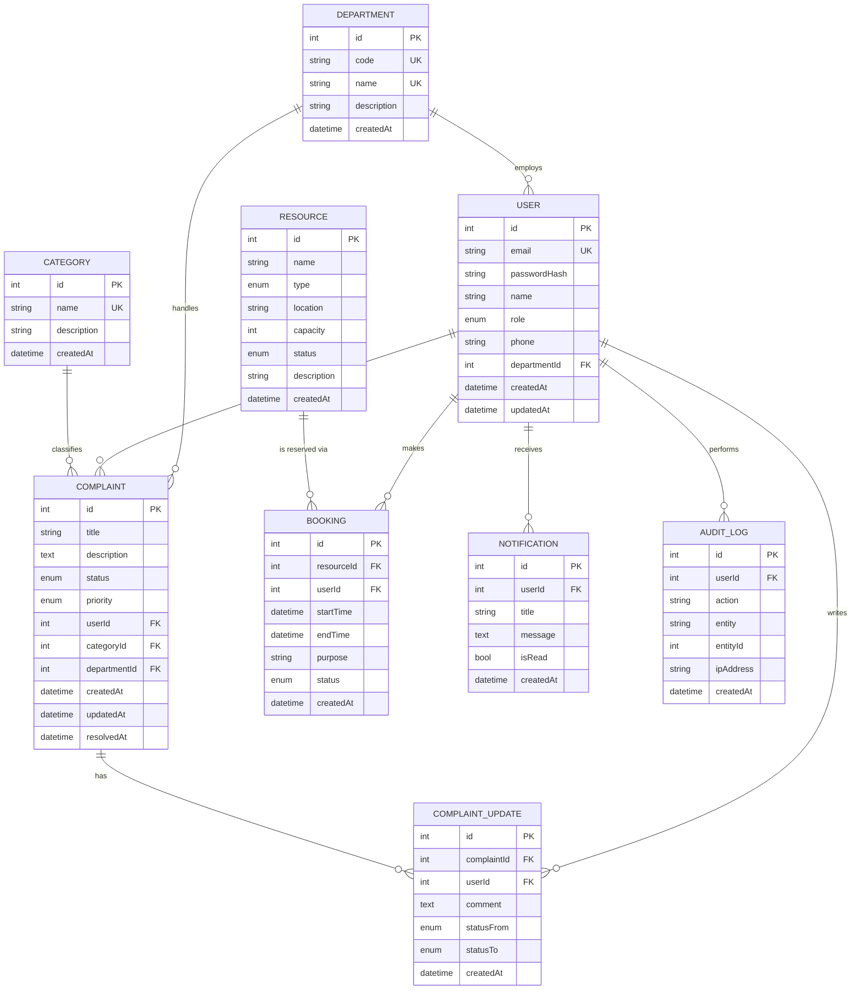

# CampusConnect — Entity Relationship (ER) Diagram

The diagram below is written in Mermaid (renders on GitHub) and reflects the exact schema
implemented in `prisma/schema.prisma`.

## Relationship Summary

| # | Relationship | Cardinality | Type |
|---|---|---|---|
| 1 | Department — User | 1 : N | One department employs many staff users |
| 2 | Department — Complaint | 1 : N | One department handles many complaints |
| 3 | User — Complaint | 1 : N | One user files many complaints |
| 4 | Category — Complaint | 1 : N | One category classifies many complaints |
| 5 | Complaint — ComplaintUpdate | 1 : N | One complaint has many updates |
| 6 | User — ComplaintUpdate | 1 : N | One user writes many updates |
| 7 | Resource — Booking | 1 : N | One resource has many bookings |
| 8 | User — Booking | 1 : N | One user makes many bookings |
| 9 | User — Notification | 1 : N | One user receives many notifications |
| 10 | User — AuditLog | 1 : N | One user performs many actions |

## Primary Entities

1. **User** — all campus members (single table, `role` column distinguishes Admin/Staff/Student)
2. **Department** — organisational units that resolve complaints
3. **Category** — complaint classification
4. **Complaint** — reported campus issues
5. **Resource** — bookable rooms/labs/equipment/vehicles
6. **Booking** — resource reservations
7. **ComplaintUpdate** — complaint status history
8. **Notification** — user alerts
9. **AuditLog** — security/audit trail
