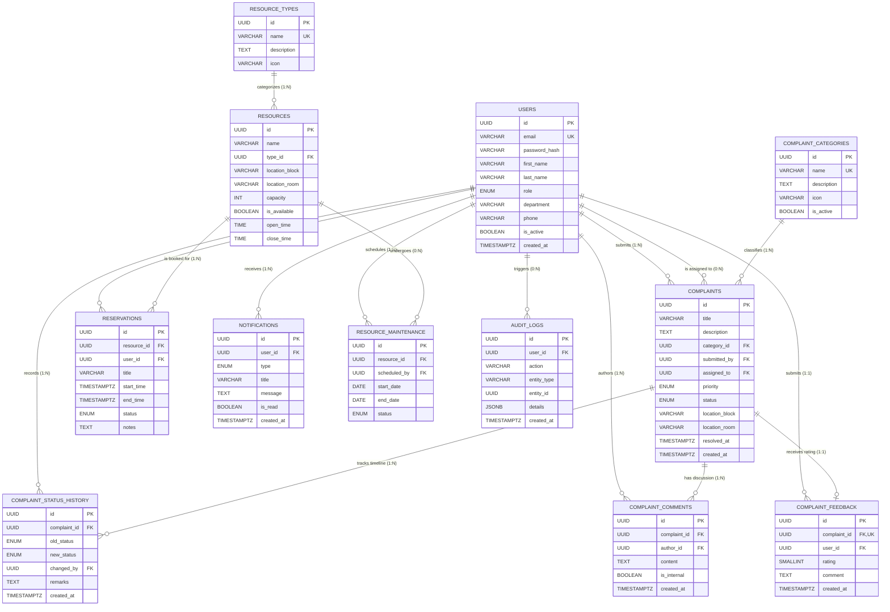

# CampusConnect — Entity Relationship (ER) Diagram & Normalization

## Course Project: Database Systems (BCSE307L)

### 1. Architectural ER Diagram (Mermaid)

---

### 2. Normalization Analysis (Third Normal Form - 3NF)

#### First Normal Form (1NF) Compliance:
- Every table has a distinct Primary Key (UUID).
- All columns contain atomic, indivisible values. Repeating groups have been separated into child relational tables (`complaint_comments`, `complaint_status_history`).

#### Second Normal Form (2NF) Compliance:
- The database is in 1NF.
- All non-key attributes are fully functionally dependent on the entire primary key (no partial dependencies on composite keys).

#### Third Normal Form (3NF) Compliance:
- The database is in 2NF.
- There are **no transitive dependencies** ($X \to Y$ and $Y \to Z$ where $X$ is primary key):
  - Category details (`name`, `icon`) are stored in `complaint_categories`, referenced via `category_id` in `complaints`.
  - Resource type specifications are isolated in `resource_types`, referenced via `type_id` in `resources`.
  - Submitter & staff details are referenced through foreign keys pointing to `users`.
