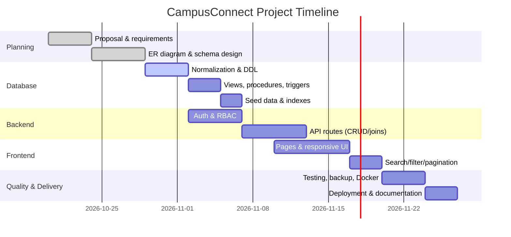

# Project Proposal

## 1. Project Title

**CampusConnect: Smart Campus Complaint & Resource Management System**

## 2. Problem Statement

University campuses handle hundreds of service requests — leaking taps, broken WiFi, faulty
lights, and room bookings — through scattered channels like phone calls, paper forms, and
informal messages. These ad-hoc processes make it hard to track an issue from report to
resolution, hard to prioritise urgent problems, and hard to know which rooms or equipment are
actually available. CampusConnect solves this by providing a single relational-database-backed
web application where students and staff can file and track complaints, and book shared campus
resources, while administrators gain a clear, real-time view of campus operations.

## 3. Objectives

1. Centralise complaint filing, tracking, and resolution in one system.
2. Provide role-based access (Admin / Staff / Student) using a single `User` table.
3. Enable booking of shared resources (rooms, labs, equipment) with conflict detection.
4. Apply a fully normalised (3NF) relational database with referential integrity.
5. Implement secure authentication (bcrypt password hashing + JWT/OAuth session).
6. Demonstrate advanced database features: views, stored procedures, triggers, transactions,
   and indexes.
7. Provide audit logging, backup/recovery, and reproducible deployment.

## 4. Scope

**In scope:**
- User authentication and role-based authorisation (3 roles).
- Complaint lifecycle: create, update status, assign department, add comments, resolve.
- Resource management and booking with overlap prevention.
- Dashboard with aggregate analytics.
- Search, filtering, and pagination on all listings.
- Form validation and exception handling.
- Backup & restore scripts, audit logging.

**Out of scope:**
- Payment processing, mobile native apps, email/SMS gateways, machine-learning analytics.

## 5. Team Members and Responsibilities

| Member | Responsibility |
|---|---|
| Member A | Database design (ERD, schema, normalization) & Prisma ORM |
| Member B | Backend API routes, authentication & RBAC |
| Member C | Frontend (React/Next.js pages, responsive UI, forms) |
| Member D | Testing, deployment, documentation & GitHub management |

## 6. Technology Stack

| Layer | Technology |
|---|---|
| Frontend | Next.js (React) 14, TypeScript |
| Backend | Next.js API routes (Node.js) |
| ORM | Prisma |
| Database | MySQL 8.4 |
| Authentication | NextAuth (JWT sessions, bcrypt hashing, Google OAuth optional) |
| Validation | Zod |
| Version Control | GitHub (main + dev branches) |
| Deployment | Docker, Docker Compose, Vercel/Railway (cloud) |

## 7. Major Deliverables

1. Project proposal and planning documents.
2. ER diagram and relational schema (3NF).
3. MySQL database (9 tables, 3 views, 2 stored procedures, 3 triggers, indexes).
4. REST API with ORM integration, CRUD, joins, aggregates, transactions.
5. Web application (login, dashboard, complaints, resources, bookings, admin panel).
6. Authentication & RBAC (single Users table, bcrypt, JWT).
7. Backup/restore scripts and Docker setup.
8. GitHub repository with README, branching, and .gitignore.

## 8. Project Timeline (Gantt Chart)

